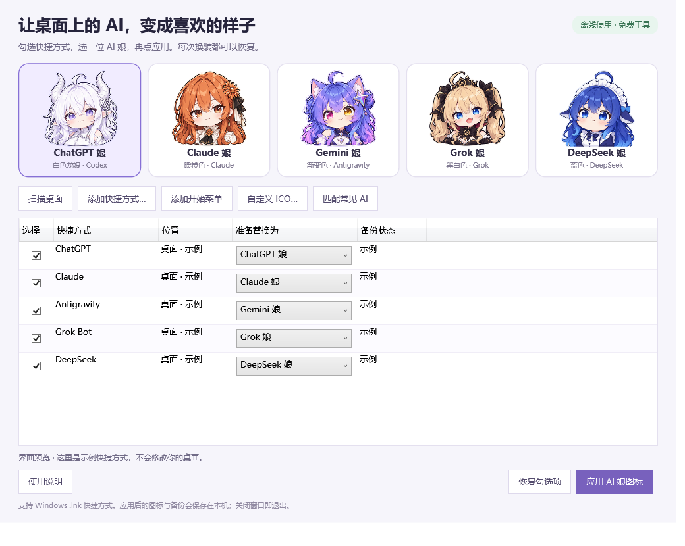

# AI 娘图标换装

把 Windows 桌面快捷方式换成喜欢的 AI 娘。内置 ChatGPT、Claude、Gemini、Grok、DeepSeek 五款角色，支持预览、批量更换、自定义 ICO 和恢复。

**[下载 Windows 程序包](https://github.com/Eclipse017/AI-Mascot-Icons/releases/latest)** · [使用说明](docs/QUICK-START.txt) · [问题反馈](https://github.com/Eclipse017/AI-Mascot-Icons/issues)



## 普通用户怎么用

1. 打开上面的下载页，在 **Assets（附件）** 中下载 `AI-Mascot-Icons-v1.0.0-windows.zip`，**先全部解压**。
2. 双击 `AI-Mascot-Icons.exe`。现代 Windows 10/11 自带所需 .NET Framework，无需安装 Python、Node.js 或 PowerShell。
3. 勾选要修改的快捷方式，再点喜欢的角色。也可点“匹配常见 AI”，检查每一行的角色建议。
4. 点“应用 AI 娘图标”，确认列表。想恢复时，勾选同一项并点“恢复勾选项”。

不需要登录或 API Key。程序离线工作，关闭窗口即可退出。安装脚本、自启动和常驻后台均不需要。

## 功能与范围

| 功能 | 说明 |
| --- | --- |
| 五款内置图标 | 所有图片和 ICO 内置在程序中 |
| 批量更换 | 每行可选不同角色，操作前列出目标 |
| 添加快捷方式 | 扫描桌面、添加开始菜单、文件选择器或拖入 `.lnk` |
| 自定义图标 | 导入最大 8 MB 的有效 ICO |
| 自动备份 | 首次修改前保存完整原文件；重复换装保留最初备份 |
| 恢复 | 原文件按字节恢复；遇到软件更新过的快捷方式会跳过 |
| 保留启动设置 | 验证目标、参数、工作目录、快捷键、窗口模式、Shell 目标和扩展元数据 |

只支持 **Windows 本地 `.lnk` 快捷方式**，不会修改应用 EXE，也不会打开目标应用。适合 Windows 10 1803 及以上和 Windows 11，需要 .NET Framework 4.7.2 或更高版本；目前在维护者的 Windows 11 机器上验证，其他系统见 [验证范围](VALIDATION.md)。

程序窗口、任务栏正在运行的图标和应用内部标识由应用控制，可能仍显示原图。macOS、Linux、`.url` 文件以及开始菜单的系统虚拟条目不在首版范围内。

“匹配常见 AI”仅根据快捷方式名称提出建议，不是应用身份检测。Gemini Notebook 不自动匹配；请检查后应用。

## 常见问题

**桌面还显示旧图标？** 在桌面按 F5。工具会通知 Windows 刷新对应文件，不会重启资源管理器或清空全局图标缓存。

**能删除下载文件夹吗？** 可以移动或删除下载包。实际使用的图标和备份会保存在 `%LOCALAPPDATA%\AI-Mascot-Icons`。使用新图标期间请保留这个数据目录；如要完全移除，先恢复全部已修改的快捷方式，再删除程序和数据目录。

**提示没有权限？** 公共桌面或公共开始菜单可能不可写。把该快捷方式复制到自己的桌面，再添加副本。工具不会请求提权。

**提示快捷方式后来被修改？** 软件更新、手动编辑或其他工具可能更改了它。为保留新的启动设置，工具会拒绝用旧备份覆盖；请创建新的快捷方式副本后操作。备份仍留在本机。

**移动或改名了快捷方式？** 备份按完整路径对应。要恢复旧备份，请把快捷方式放回原路径；如需换一个位置，建议先恢复、移动后再换装。

**程序能控制 AI 吗？** 这是快捷方式换图标工具。它不会启动 Claude 或其他 AI 客户端、网页、CLI、保护启动器，也没有调用模型的代码。

**Windows 提示未知发布者？** 当前版本没有商业代码签名。可核对下载页提供的 SHA-256，或审阅源码后自行构建；组织管理的电脑应遵守组织策略，不要关闭安全软件。

## 从源码构建

构建需要 Windows、PowerShell 7 和 .NET Framework 自带的 C# 编译器；不下载 NuGet 包，不要求额外 .NET SDK。

```powershell
pwsh -NoProfile -File ./scripts/Build.ps1 -Test
pwsh -NoProfile -File ./scripts/Package.ps1
```

程序输出到 `artifacts/build`；分发 ZIP、源码 ZIP、校验值输出到 `artifacts/releases`。测试只用临时目录里的无效目标快捷方式，不会运行真实 AI 应用。界面按钮测试可用测试程序的 `--ui` 参数加载隔离文件。

## 许可与来源

代码和文档采用 [MIT](LICENSE)。角色图片和图标单独适用 [素材说明](ASSETS.md)，不能把 MIT 代码许可理解为角色图案可以任意商用。项目为非官方爱好工具，与所提及品牌没有隶属或授权背书关系。

技术依据：[Microsoft Shell 快捷方式图标接口](https://learn.microsoft.com/en-us/windows/win32/api/shobjidl_core/nf-shobjidl_core-ishelllinkw-seticonlocation)、[.NET Framework 系统要求](https://learn.microsoft.com/en-us/dotnet/framework/get-started/system-requirements)。

小红书文案和截图建议见 [分享文案](docs/XIAOHONGSHU.md)。
